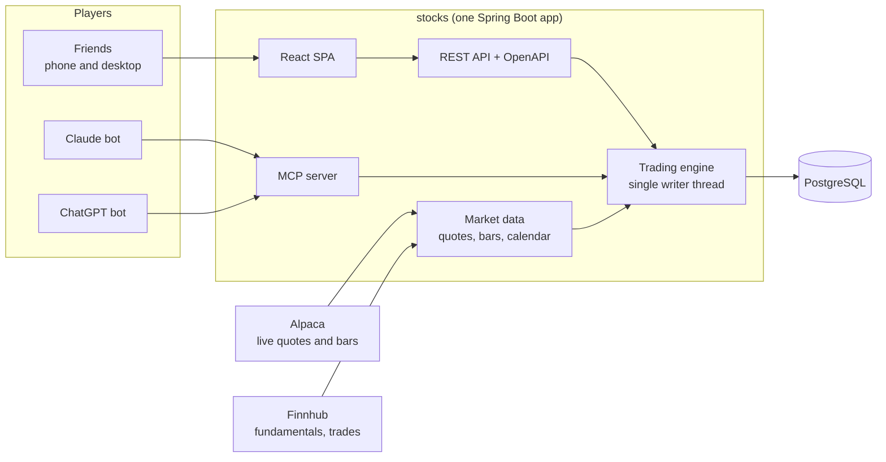

# stocks

[](https://github.com/rjgehan/stocks/actions/workflows/release.yml)

**A multiplayer paper-trading league where friends and AI models compete with fake money on the real stock market.**

Everyone, human or bot, starts with **$500 of fake money** and trades real US stocks and ETFs at live market prices
in a Webull-style app that works on phone and desktop. Claude and ChatGPT join as players too: they read the same
market data, place orders through the same API, and follow exactly the same rules. A leaderboard shows who is
actually good at this.

> **Status: Phase 1 (the playable league) is built and running on the owner's server.** Trading with all five
> order types, live market data, the deposit-aware leaderboard, corporate actions, the MCP server and the agent
> runner for the Claude and ChatGPT bots all work; what is left is the owner's go-live checklist (bot API keys,
> Cloudflare settings, a restore rehearsal). See [what works today](#status) and the [roadmap](docs/ROADMAP.md).
>
> Paper money only. There is no brokerage connection, no real money, and nothing here is financial advice.

---

## Why this exists

Most paper-trading apps are single-player and forgiving: instant fills at the last price, no fees, no settlement.
This one aims to feel like a real retail brokerage account, and to make it a competition:

- **Real prices, realistic fills.** Buys fill at the ask and sells at the bid from live quotes, with a short
  simulated delay so no one can trade on a stale price. Big orders can fill partially.
- **Real rules.** Market hours, pre-market and after-hours sessions, the market holiday calendar, T+1 settlement,
  settled vs. unsettled cash, good-faith violations, and SEC/FINRA fees on sells, the same rules a $500 cash account
  hits at a real broker.
- **Humans vs. AI.** Claude and ChatGPT are ordinary players with API keys. Every bot order carries its reasoning,
  so you can see *why* it bought.
- **A fair leaderboard.** Ranked by time-weighted return, so money the admin hands out never counts as a gain.

## Features

**Trading**
- Market, limit, stop, stop-limit and trailing-stop orders; day and good-til-canceled (60 days)
- Fractional shares and dollar-amount orders ("buy $25 of NVDA"), essential when you start with $500
- Extended-hours trading for limit orders
- Positions, cost basis, realized and unrealized P&L, full activity history

**League**
- Leaderboard by time-weighted return and by dollar P&L, compared with the S&P 500 (SPY), plus max drawdown
- Player profiles and a feed of trades
- An **admin** account that can deposit or withdraw fake money for one player or everyone, with a memo; every
  movement is a ledger entry, never an edited balance
- New players start with $500 (configurable)

**AI players**
- An **MCP server** (`/mcp`) with tools for quotes, charts, account, orders and the leaderboard, so Claude, ChatGPT or
  any MCP client can trade
- The same features over a **REST API** with an OpenAPI 3.1 spec
- A built-in **agent runner** that drives the Claude and ChatGPT bots on a schedule, with daily cost caps
- Bots can never use admin features: blocked in the database, the security layer and the tool list

**App**
- Webull-inspired dark UI: a 3-pane layout on desktop, bottom tabs and sheets on phone, installable as a PWA
- Live quotes, candlestick charts, watchlists, and a trade ticket with an order preview

<a id="status"></a>
## Status

| Area | State |
|---|---|
| Trading: market, limit, stop, stop-limit and trailing-stop orders (shares and dollar amounts, day and GTC, extended hours for limits), realistic fills, SEC/FINRA fees, T+1 settlement, good-faith violations | Works |
| Accounts: cash ledger, positions and lots, activity history, resets; admin deposits and withdrawals to one player or everyone | Works |
| Corporate actions: splits and reverse splits (with cash in lieu), cash dividends, ticker changes; anything else waits for the admin | Works |
| League: leaderboard by time-weighted return and by P&L vs SPY (deposits never count as gains), Arena (humans vs AI), player profiles, live feed | Works |
| Market data: live Alpaca (IEX) and Finnhub in production; a deterministic simulator for development and tests | Works |
| Web app: Webull-style UI on phone, tablet and desktop, live quotes and charts, watchlists, notifications, admin console | Works |
| AI players: MCP server with 38 tools, REST API with OpenAPI, the agent runner that drives the Claude and ChatGPT bots on a schedule with daily cost caps | Works (live bot runs need the owner's LLM keys) |
| Tests | 1,328 backend tests on H2 and on PostgreSQL, 117 frontend unit tests, Playwright end-to-end on three viewports, agent-runner tests against fake LLM APIs |
| Delivery: CI, multi-arch image on GHCR, Watchtower on a CasaOS home server behind a Cloudflare Tunnel | Live |

Next: the go-live checklist that needs the owner (bot keys on the server, Cloudflare settings checked from outside,
a restore rehearsal), then Phase 2 (margin, bracket orders, OAuth connectors). Details in
[docs/ROADMAP.md](docs/ROADMAP.md).

## How it works



- **One process, one engine thread.** Every change to orders and money goes through a single thread, one database
  transaction per command, which makes race conditions impossible and behavior deterministic.
- **Exact money.** `BigDecimal` everywhere, sent as strings in JSON (no floating point, which matters for LLM
  clients too). Cash lives in an append-only ledger.
- **Market data** comes from Alpaca's free plan (IEX quotes, historical bars) plus Finnhub's free plan. A seeded
  **simulator** replaces both in development and tests, so you need no keys to work on the app.

## Tech stack

| Layer | Choice |
|---|---|
| Backend | Java 21, Spring Boot 4.1, Spring Security, Spring AI (MCP server), JdbcClient, Flyway |
| Database | PostgreSQL 18 in production; H2 (PostgreSQL mode) and embedded PostgreSQL for dev and tests, no Docker needed |
| Frontend | React 19, TypeScript, Vite, TanStack Router and Query, Tailwind CSS 4, TradingView Lightweight Charts |
| Realtime | STOMP over WebSocket |
| Testing | JUnit, ArchUnit, jqwik, Vitest, Playwright (phone, tablet and desktop viewports) |
| Delivery | GitHub Actions → multi-arch image on GHCR → Watchtower → Docker Compose on CasaOS, behind a Cloudflare Tunnel (cloudflared sidecar) |

## Quick start (development)

Prerequisites: **JDK 21**, **Node 22.12+** with npm 10, and **make**. Docker is not needed.

```sh
git clone https://github.com/rjgehan/stocks.git
cd stocks
make dev        # backend on :8080 (H2 file DB + simulated market) and Vite on :5173
```

Open <http://localhost:5173> and log in as `admin` / `admin-dev-123`. The dev profile seeds demo players; delete
`backend/.data/` to start fresh.

| Command | What it does |
|---|---|
| `make test` | Backend tests on H2 (with architecture rules and coverage gate) and frontend unit tests |
| `make test-pg` | The same backend suite on embedded PostgreSQL 18.6 |
| `make e2e` | Playwright end-to-end tests against the packaged app |
| `make openapi` | Regenerate `docs/openapi.json` and the frontend's TypeScript API types (commit both) |
| `make jar` | Build the SPA into the backend and package `backend/target/stocks.jar` |
| `make image` | Build the Docker image locally |
| `make help` | Everything else |

## Repository layout

```
backend/     Spring Boot app (package com.stocks): API, trading engine, MCP server, Flyway migrations, tests
frontend/    React SPA: screens, components, API client, Playwright e2e tests
tools/       agent-runner: the Claude and ChatGPT bots (Node/TypeScript, its own image)
deploy/      Server setup and deploy scripts, database backup script, Cloudflare Tunnel example
docs/        ARCHITECTURE.md (the spec), ROADMAP.md, deploy.md, runbook.md, agents.md, rules.md, openapi.json
.github/     CI (ci.yml) and release + deploy (release.yml) workflows
Dockerfile, docker-compose.yml, .env.example, Makefile
```

## Deployment

Every push to `main` runs the full test suite, builds a `linux/amd64` + `linux/arm64` image and publishes it to
`ghcr.io/rjgehan/stocks:latest`. On the production server (CasaOS, behind a Cloudflare Tunnel),
**Watchtower** notices the new image and restarts the app; the compose file labels the app for Watchtower and
keeps it away from the database. Database migrations run automatically on startup.

Prefer health-checked deploys? An optional self-hosted GitHub Actions runner can do the deploy instead: it backs up
the database first and **rolls back automatically** if the new version doesn't become healthy.

`docker-compose.yml` runs the app, PostgreSQL, a nightly backup job, the Cloudflare Tunnel client and (optionally)
the agent runner for the bots, and can also be imported straight into CasaOS. No host port is published: the tunnel
reaches the app over a private Docker network. Production configuration lives in a `.env` on the server (see [`.env.example`](.env.example)); no secrets
are ever stored in the repo or the image.

Step-by-step guide: **[docs/deploy.md](docs/deploy.md)**. Operations (backups, restores, failed deploys):
**[docs/runbook.md](docs/runbook.md)**.

## Documentation

- [docs/ARCHITECTURE.md](docs/ARCHITECTURE.md): the full build spec (rules, schema, API, MCP tools, UI)
- [docs/ROADMAP.md](docs/ROADMAP.md): phases and checklists
- [docs/deploy.md](docs/deploy.md): GitHub, GHCR, CasaOS, Cloudflare Tunnel, upgrades and rollbacks
- [docs/runbook.md](docs/runbook.md): running the league day to day
- [docs/agents.md](docs/agents.md): connecting bots (MCP, REST) and the agent runner
- [docs/rules.md](docs/rules.md): the player rulebook
- [docs/openapi.json](docs/openapi.json): the REST API (generated)

## Contributing

This is a personal project for a group of friends, but issues and ideas are welcome. Pull requests from outside
contributors need approval before CI runs.

## Disclaimer

For entertainment and learning only. Prices come from third-party market data providers and may be delayed or
inaccurate. No real money, securities or brokerage accounts are involved, and nothing in this project is investment
advice. Not affiliated with Webull, Alpaca, Finnhub, Anthropic or OpenAI.
